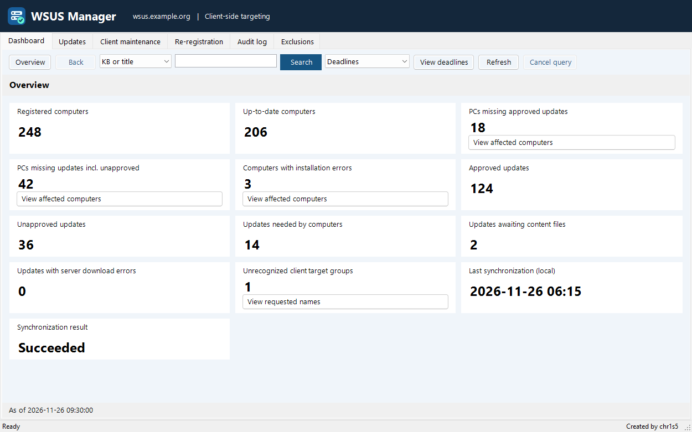

<p align="center">
  
</p>

<h1 align="center">WSUS Manager</h1>

<p align="center"><a href="README.md" lang="de">Deutsch</a> · <strong>English</strong></p>

<p align="center">
  Trace missing updates to an individual PC, set installation deadlines by group,<br>
  and find out why a client has stopped reporting.
</p>

<p align="center"><strong>Version 1.1.0</strong> · Windows · by <a href="https://github.com/chr1s5">chr1s5</a></p>

<p align="center">
  <a href="#quick-start">Quick start</a> ·
  <a href="#requirements">Requirements</a> ·
  <a href="#features">Features</a> ·
  <a href="#client-diagnostics">Client diagnostics</a> ·
  <a href="#parameters">Parameters</a> ·
  <a href="#project">Project</a>
</p>



*Dashboard with sample data. Choose **View affected computers** to go from a count to the list of PCs. Double-click a PC to see its updates.*

## Quick start

Download the repository using **Code → Download ZIP**, extract it, and open PowerShell in the folder containing `WSUS-Manager.ps1`. If you use Git, these commands take you to the project folder.

```powershell
git clone https://github.com/chr1s5/WSUS-Manager.git
Set-Location .\WSUS-Manager
```

Replace `wsus.example.org` with the DNS name of your WSUS server. Both examples connect over HTTPS on port `8531`.

### Start with Windows PowerShell 5.1

```powershell
powershell.exe -NoProfile -STA -File .\WSUS-Manager.ps1 -Server wsus.example.org -UseSsl
```

### Start with PowerShell 7

```powershell
pwsh.exe -NoProfile -File .\WSUS-Manager.ps1 -Server wsus.example.org -UseSsl
```

When launched with `pwsh.exe`, the script opens a Windows PowerShell 5.1 process for the graphical console and passes your parameters to it. A local client scan with `-EndpointScan` runs directly in the PowerShell process that launched it.

For HTTP on port `8530`, omit `-UseSsl`. To specify a different port, add `-Port`. On the WSUS server itself, run `.\WSUS-Manager.ps1` to open a local connection.

## Requirements

| Where | What you need |
| --- | --- |
| **Administration workstation** | Windows with a desktop session, Windows PowerShell 5.1, and the **WSUS management tools**, including the `UpdateServices` module. Install PowerShell 7 as well if you want to launch with `pwsh.exe`. The Windows PowerShell 5.1 execution policy must allow the script to run. |
| **WSUS server** | A reachable WSUS instance. The manager uses your current Windows account. Reports require read access. Approvals and re-registration require the corresponding administrative permissions. For a replica, make these changes on its upstream server. |
| **Managed clients** | Remote scans and event log queries require PowerShell remoting over WinRM, Kerberos, and the appropriate permissions on the target. For a local scan, you need a Windows client with an active WSUS policy and the Windows Update Agent. |

On the administration workstation, check that Windows PowerShell 5.1 can find the module.

```powershell
powershell.exe -NoProfile -Command "Get-Module -ListAvailable -Name UpdateServices"
```

If the command returns no output, install **Windows Server Update Services Tools**. [Installation guide on Microsoft Learn](https://learn.microsoft.com/en-us/windows-server/administration/install-remote-server-administration-tools)

## Features

| Task | How to use it |
| --- | --- |
| **Find missing updates** | The **Dashboard** shows which PCs are missing approved updates and how many have outstanding updates when unapproved ones are included. Open the affected computers and then the KBs for an individual PC. You can also search by KB, title, or computer name. |
| **Set deadlines by target group** | In **Updates**, select the groups and updates. With **Review group deadlines ...**, you can give pilot devices an earlier deadline and production servers a later one for the same update. Review the preview and confirm the approvals. |
| **Track upcoming deadlines** | **Dashboard → View deadlines** shows the effective group, installation deadline, and last WSUS report for each PC and update. Separate views cover overdue deadlines, deadlines in the next seven days, and pending restarts. |
| **Search large result lists** | Type part of a word in the table filter. Terms can match across columns, with the best matches listed first. Click a column heading to sort. In computer views, you can select all matching devices. Use **Cancel query** or **Esc** to cancel a running search. |
| **Narrow the scope of approvals** | Include previously approved updates and hide superseded updates as needed. Under **Exclusions**, exclude updates from approval by KB, update GUID, or a title pattern such as `Title:*Preview*`. |
| **Trace actions** | **Audit log** records actions as JSONL in `%LOCALAPPDATA%\WSUS-Manager` by default. Choose a writable central share with **Log location ...** or `-LogDirectory`. If a write to the share fails, the manager continues logging locally. |

Dashboard detail views display up to 100 rows per page and reuse cached results as you browse. Canceling a query frees the view for another search. A WSUS call already in progress can take longer to finish in the background.

## Client diagnostics

### Check reachability on demand

Select the PCs and click **Check online**. Results appear in the computer list. Click a status dot to see the check time, the IP recorded in WSUS, the addresses returned by DNS, and the ping results.

| Status | Meaning |
| --- | --- |
| ⚪ **Not checked** | No check result is available for this computer yet. |
| 🟢 **Reachable** | The DNS name resolves to the IP recorded in WSUS and that IP replies to ping. |
| 🔴 **No reply / Unverified** | The WSUS IP did not reply or the address could not be verified. Open the details to distinguish a missing ping reply from a DNS mismatch. ICMP filtering can also prevent a reply. |

### When a client stops reporting

1. In **Client maintenance**, choose the target groups and the minimum age of the last report. Click **Load overdue clients**, select a computer, and choose **Check ReAdd readiness**. The manager checks device identity, DNS, and group membership. With client-side targeting, it reads the effective policy values whether they were set by GPO or as static registry values.
2. Request a scan with **Request new report ...**. Follow its progress in **Re-registration → Open timeline**. Use **Windows Update events ...** to retrieve entries from the client's `Microsoft-Windows-WindowsUpdateClient/Operational` log on demand.
3. If the scan succeeds but no fresh report arrives, wait for the grace period and open **Review re-registration ...**. The default is 15 minutes. Use `-ReportGraceMinutes` to change it.
4. When the client returns, check its new report and group memberships. With server-side targeting, use **Assign groups ...** to review and restore missing groups.

> [!IMPORTANT]
> Confirming removal in the ReAdd preview deletes the existing WSUS computer record, including its history and group memberships, and triggers a new scan. The client keeps the target group settings supplied by Group Policy or static registry values.

### Scan one client locally

Run the command on the affected Windows device. It uses the Windows Update Agent and reports the number of outstanding updates. The optional URL checks that the configured update server and reporting server match the expected address before the search starts.

```powershell
.\WSUS-Manager.ps1 -EndpointScan -ClientWsusUrl 'https://wsus.example.org:8531'
```

The client can run this mode without the graphical console or the `UpdateServices` module.

## Parameters

| Parameter | Effect |
| --- | --- |
| `-Server` | DNS name of the WSUS server. Omit all connection parameters to use the local WSUS server. |
| `-UseSsl`, `-Port` | Enable HTTPS or specify a port. Explicit connections default to 8530 for HTTP and 8531 for HTTPS. |
| `-ClientWsusUrl` | WSUS address expected in the client policy, for example when clients use a DNS alias. |
| `-CacheMinutes` | Dashboard cache lifetime in minutes. Default 5, allowed range 1 to 1440. |
| `-ReportGraceMinutes` | Time to wait for a fresh report before ReAdd removal. Default 15 minutes, allowed range 1 to 1440. |
| `-LogDirectory` | Local folder or UNC share for JSONL audit logs. Exclusions, re-registration history, and the dashboard cache stay under `%LOCALAPPDATA%\WSUS-Manager`. |
| `-EndpointScan` | Run a local WSUS scan on the current computer. A remote scan from the GUI can run without copying the script to the client. |

## Project

- **Contributing** · Report an issue, propose a change, and run local checks. [Contribution guide](CONTRIBUTING.md)
- **Security** · Report a security concern privately. [Security policy](SECURITY.md)
- **Releases** · Validate and publish a version on GitHub. [Release guide](docs/PUBLISHING.md)
- **License** · WSUS Manager is distributed under the [MIT License](LICENSE).
