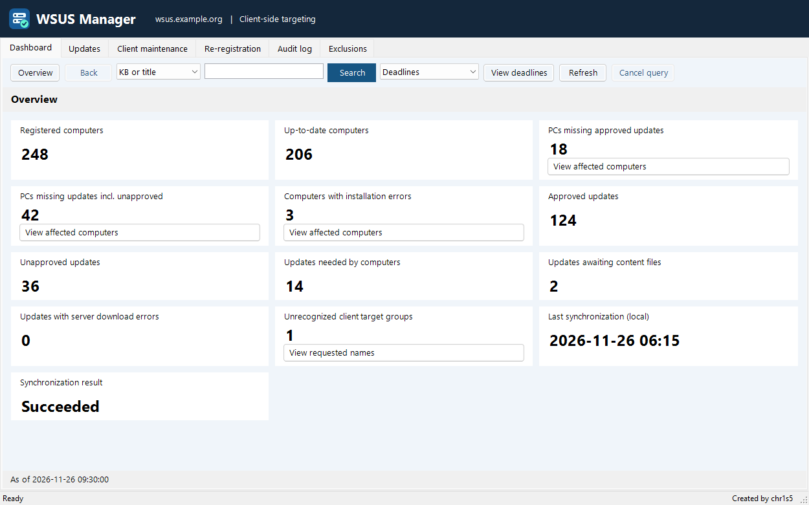

<p align="center">
  
</p>

<h1 align="center">WSUS Manager</h1>

<p align="center"><strong>Deutsch</strong> · <a href="README.en.md" lang="en">English</a></p>

<p align="center">
  Fehlende Updates bis zum einzelnen PC verfolgen, Installationsfristen je Gruppe setzen<br>
  und herausfinden, warum ein Client keinen neuen Bericht liefert.
</p>

<p align="center"><strong>Version 1.1.0</strong> · Windows · von <a href="https://github.com/chr1s5">chr1s5</a></p>

<p align="center">
  <a href="#schnellstart">Schnellstart</a> ·
  <a href="#voraussetzungen">Voraussetzungen</a> ·
  <a href="#funktionen">Funktionen</a> ·
  <a href="#clientdiagnose">Clientdiagnose</a> ·
  <a href="#startparameter">Startparameter</a> ·
  <a href="#projekt">Projekt</a>
</p>



*Dashboard mit Beispieldaten. Über **View affected computers** gelangst du von der Kennzahl zur Liste der betroffenen PCs. Ein Doppelklick auf einen PC zeigt die zugehörigen Updates.*

## Schnellstart

Lade das Repository über **Code → Download ZIP** herunter, entpacke es und öffne PowerShell im Ordner mit `WSUS-Manager.ps1`. Wenn du Git verwendest, kommst du mit diesen beiden Befehlen in den Projektordner.

```powershell
git clone https://github.com/chr1s5/WSUS-Manager.git
Set-Location .\WSUS-Manager
```

Ersetze `wsus.example.org` durch den DNS-Namen deines WSUS-Servers. Beide Beispiele verbinden sich per HTTPS auf Port `8531`.

### Mit Windows PowerShell 5.1 starten

```powershell
powershell.exe -NoProfile -STA -File .\WSUS-Manager.ps1 -Server wsus.example.org -UseSsl
```

### Mit PowerShell 7 starten

```powershell
pwsh.exe -NoProfile -File .\WSUS-Manager.ps1 -Server wsus.example.org -UseSsl
```

Beim Start mit `pwsh.exe` öffnet das Skript für die grafische Konsole einen Windows-PowerShell-5.1-Prozess und übergibt alle Startparameter. Der lokale Clientscan mit `-EndpointScan` läuft direkt in der aufrufenden PowerShell.

Für HTTP auf Port `8530` lässt du `-UseSsl` weg. Einen abweichenden Port gibst du mit `-Port` an. Direkt auf dem WSUS-Server kannst du die lokale Verbindung mit `.\WSUS-Manager.ps1` öffnen.

## Voraussetzungen

| Wo | Was benötigt wird |
| --- | --- |
| **Verwaltungsrechner** | Windows mit grafischer Oberfläche, Windows PowerShell 5.1 und installierten **WSUS-Verwaltungstools** mit dem Modul `UpdateServices`. Für den Start mit `pwsh.exe` zusätzlich PowerShell 7. Die Ausführungsrichtlinie von Windows PowerShell 5.1 muss den Skriptstart erlauben. |
| **WSUS-Server** | Eine erreichbare WSUS-Instanz. Der Manager verwendet dein angemeldetes Windows-Konto. Für Berichte braucht es Leserechte, für Freigaben und erneute Registrierungen entsprechende Verwaltungsrechte. Bei einem Replikat erfolgen diese Änderungen am zuständigen Upstream-Server. |
| **Verwaltete Clients** | Für Remote-Scans und Ereignisprotokolle müssen PowerShell-Remoting über WinRM, Kerberos und die passenden Rechte auf dem Zielgerät verfügbar sein. Für einen lokalen Scan genügt ein Windows-Client mit aktiver WSUS-Richtlinie und Windows Update Agent. |

Prüfe auf dem Verwaltungsrechner, ob Windows PowerShell 5.1 das Modul findet.

```powershell
powershell.exe -NoProfile -Command "Get-Module -ListAvailable -Name UpdateServices"
```

Bleibt die Ausgabe leer, installiere die Komponente **Windows Server Update Services Tools**. [Installationsanleitung bei Microsoft Learn](https://learn.microsoft.com/de-de/windows-server/administration/install-remote-server-administration-tools)

## Funktionen

| Aufgabe | So gehst du vor |
| --- | --- |
| **Fehlende Updates finden** | Im **Dashboard** siehst du, auf welchen PCs freigegebene Updates fehlen und wie viele PCs unter Einbezug nicht freigegebener Updates einen Rückstand haben. Öffne die betroffenen Computer und anschließend die KBs des einzelnen PCs. Du kannst auch nach KB, Titel oder Computername suchen. |
| **Fristen je Zielgruppe setzen** | Wähle unter **Updates** die Gruppen und Updates aus. Mit **Review group deadlines ...** kannst du für dasselbe Update etwa den Pilotgeräten eine frühere und den Produktionsservern eine spätere Frist geben. Prüfe die Vorschau und bestätige die Freigaben. |
| **Fälligkeiten überwachen** | **Dashboard → View deadlines** zeigt pro PC und Update die wirksame Gruppe, den Installationstermin und den letzten WSUS-Bericht. Eigene Ansichten zeigen überfällige Fristen, die nächsten sieben Tage und ausstehende Neustarts. |
| **Große Listen durchsuchen** | Tippe Wortteile in den Tabellenfilter, auch aus mehreren Spalten. Die besten Treffer stehen zuerst. Ein Klick auf eine Spaltenüberschrift sortiert die Liste. In Computeransichten kannst du alle passenden Geräte auswählen. Laufende Suchabfragen lassen sich mit **Cancel query** oder **Esc** abbrechen. |
| **Freigaben eingrenzen** | Blende bereits genehmigte Updates bei Bedarf ein und ersetzte Updates aus. Unter **Exclusions** kannst du Updates für die Freigabe per KB, Update-GUID oder Titelmuster wie `Title:*Preview*` ausschließen. |
| **Aktionen nachvollziehen** | **Audit log** protokolliert Aktionen als JSONL, standardmäßig unter `%LOCALAPPDATA%\WSUS-Manager`. Über **Log location ...** oder `-LogDirectory` kannst du eine zentrale Freigabe mit Schreibzugriff wählen. Ist sie beim Schreiben unerreichbar, protokolliert der Manager lokal weiter. |

Das Dashboard zeigt Detailergebnisse auf Seiten mit bis zu 100 Zeilen. Beim Blättern verwendet es die zwischengespeicherten Ergebnisse. Ein Abbruch gibt die Ansicht für die nächste Suche frei. Ein bereits laufender WSUS-Aufruf kann im Hintergrund noch auslaufen.

## Clientdiagnose

### Erreichbarkeit auf Abruf

Markiere die gewünschten PCs und klicke auf **Check online**. Das Ergebnis erscheint direkt in der Computerliste. Ein Klick auf den Statuspunkt öffnet die Details mit Prüfzeit, WSUS-IP, aufgelösten DNS-Adressen und Ping-Ergebnissen.

| Punkt | Bedeutung |
| --- | --- |
| ⚪ **Not checked** | Für diesen Computer liegt noch kein Prüfergebnis vor. |
| 🟢 **Reachable** | Der DNS-Name löst auf die in WSUS gespeicherte IP auf und diese IP antwortet auf Ping. |
| 🔴 **No reply / Unverified** | Die WSUS-IP antwortet nicht oder die Zuordnung ließ sich nicht bestätigen. Die Detailansicht unterscheidet eine fehlende Ping-Antwort von einer abweichenden DNS-Auflösung. Auch gefiltertes ICMP kann eine Antwort verhindern. |

### Wenn ein Client keinen neuen Bericht liefert

1. Wähle unter **Client maintenance** die Zielgruppen und das Mindestalter des letzten Berichts. Klicke auf **Load overdue clients**, markiere einen Computer und wähle **Check ReAdd readiness**. Der Manager prüft Geräteidentität, DNS und Gruppenzuordnung. Bei clientseitiger Zuordnung liest er die wirksamen Richtlinienwerte, unabhängig davon, ob sie per GPO oder als statische Registry-Werte gesetzt wurden.
2. Fordere mit **Request new report ...** einen Scan an. Unter **Re-registration → Open timeline** siehst du den Verlauf. Über **Windows Update events ...** kannst du bei Bedarf die Ereignisse aus `Microsoft-Windows-WindowsUpdateClient/Operational` auf dem Client abrufen.
3. Bleibt ein frischer Bericht trotz erfolgreichem Scan aus, kannst du nach der Wartefrist **Review re-registration ...** öffnen. Die Frist beträgt standardmäßig 15 Minuten und lässt sich mit `-ReportGraceMinutes` anpassen.
4. Prüfe nach der Rückkehr des Clients seinen neuen Bericht und die Gruppenmitgliedschaften. Bei serverseitiger Zuordnung kannst du fehlende Gruppen über **Assign groups ...** prüfen und wiederherstellen.

> [!IMPORTANT]
> Bestätigst du die Entfernung in der ReAdd-Vorschau, löscht der Manager den bisherigen WSUS-Computerdatensatz einschließlich Verlauf und Gruppenmitgliedschaften und stößt einen neuen Scan an. Die clientseitige Gruppenrichtlinie und die statischen Registry-Werte für die Zielgruppe bleiben dabei erhalten.

### Einen einzelnen Client lokal scannen

Führe den Befehl auf dem betroffenen Windows-Gerät aus. Er nutzt dessen Windows Update Agent und gibt die Anzahl ausstehender Updates aus. Die optionale URL lässt den Manager vor der Suche prüfen, ob der konfigurierte Update- und Berichtsserver der erwarteten Adresse entspricht.

```powershell
.\WSUS-Manager.ps1 -EndpointScan -ClientWsusUrl 'https://wsus.example.org:8531'
```

Dieser Modus benötigt auf dem Client weder die grafische Konsole noch das Modul `UpdateServices`.

## Startparameter

| Parameter | Wirkung |
| --- | --- |
| `-Server` | DNS-Name des WSUS-Servers. Ohne Verbindungsparameter verwendet der Manager den lokalen WSUS-Server. |
| `-UseSsl`, `-Port` | HTTPS aktivieren oder einen Port vorgeben. Bei expliziter Verbindung gelten standardmäßig 8530 für HTTP und 8531 für HTTPS. |
| `-ClientWsusUrl` | Erwartete WSUS-Adresse in der Clientrichtlinie, etwa bei einem DNS-Alias. |
| `-CacheMinutes` | Gültigkeit des Dashboard-Caches in Minuten. Standard 5, zulässig 1 bis 1440. |
| `-ReportGraceMinutes` | Wartezeit auf einen neuen Bericht vor einer ReAdd-Entfernung. Standard 15 Minuten, zulässig 1 bis 1440. |
| `-LogDirectory` | Lokaler Ordner oder UNC-Freigabe für JSONL-Auditprotokolle. Ausnahmen, ReAdd-Verläufe und Dashboard-Cache liegen weiterhin unter `%LOCALAPPDATA%\WSUS-Manager`. |
| `-EndpointScan` | Führt auf dem aktuellen Computer einen lokalen WSUS-Scan aus. Für einen Remote-Scan aus der GUI musst du das Skript nicht auf den Client kopieren. |

## Projekt

- **Mitwirken** · Fehler melden, Änderungen vorschlagen und lokale Tests ausführen. [Leitfaden für Beiträge](CONTRIBUTING.md)
- **Sicherheit** · Sicherheitsprobleme vertraulich melden. [Sicherheitsrichtlinie](SECURITY.md)
- **Veröffentlichungen** · Eine Version prüfen und auf GitHub veröffentlichen. [Release-Leitfaden](docs/PUBLISHING.md)
- **Lizenz** · WSUS Manager steht unter der [MIT-Lizenz](LICENSE).
